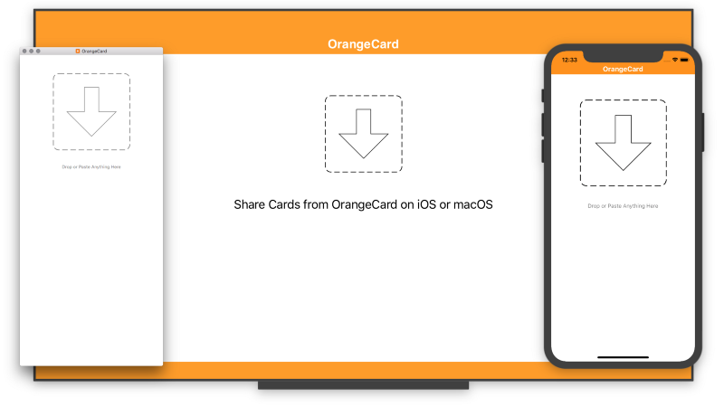
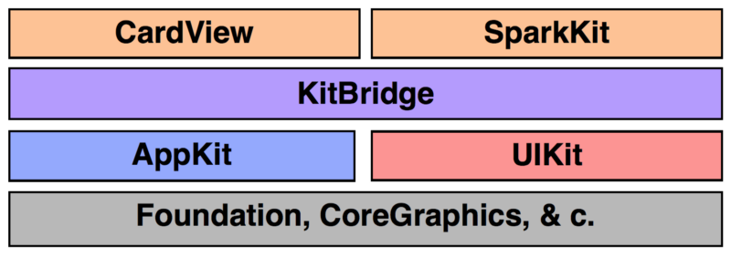

# KitBridge 

KitBridge: Bringing UIKit and AppKit Closer Together, in Swift

From [iStumbler Labs](https://istumbler.net/labs/).

## Contents 

- [Goals](#goals)
- [Support](#support)
- [Bridged Types](#types)
- [Extensions](#extensions)
- [Model Controller Multiple Views](#mcmv)
- [Custom Fonts](#fonts)
- [To Do Items](#todo)
- [Version History](#versions)
- [MIT License](#license)

## Goals 

KitBridge allows you to create views which can be used in both iOS and macOS applications.

KitBridge supports [CardView](https://github.com/iStumblerLabs/CardView), 
[SparkKit](https://github.com/iStumblerLabs/SparkKit),
which offer a nice looking text view subclass, and a simple fast graphing toolkit as well as
other iStumbler Labs frameworks.

Overall the goal of KitBridge is to provide *just enough* support to make writing apps which target
multiple platforms and UI modes easier, but without trying to emulate the iOS/tvOS app runtime on
macOS or vice versa.

Apps will have a single set of source files and one plist for each platform they want to target; 
along with storyboards, xibs, xcassets, and other platform specific resources.

## Support KitBridge! 

Are you using KitBridge in your apps? Would you like to help support the project and get a sponsor credit?

Visit our [Patreon Page](https://www.patreon.com/istumblerlabs) and patronize us in exchange for great rewards!

## Bridged Types 

[`Platform.swift`](./Sources/KitBridge/Platform.swift) defines `typealias`es which let you write a kit class name,
e.g. `ILColor`, which is `NSColor` on the Mac and `UIColor` on the iPhone, iPad, TV, Vision Pro and watch.
Use `#if os(macOS)` or `#if canImport(AppKit)` to separate implementations when needed.

On the watch and visionOS, which have no `UIScreen`, `ILScreen` stands in with the scale images are drawn at,
and `ILScreen.mainScale` is the main screen's scale on every platform, from any thread.

## Extensions 

Extensions on AppKit's classes adapt them to UIKit's API, and the semantic colors of each are available on both,
so an app can use one spelling throughout.

- [`ILColor+KitBridge`](./Sources/KitBridge/ILColor+KitBridge.swift)
  - `ILColor(css:)` reads CSS colors: `#FFF`, `#FFFFFF`, `#FFFFFF80`, `rgb()`, `rgba()`, `hsl()` and `hsla()`
  - `cssHex`, `cssRGB`, `cssRGBA`, `cssHSL`, `cssHSLA` and `colorName` write them
  - `complementary` and `contrasting` colors, `ciColor` on AppKit
  - The semantic colors of AppKit and UIKit on both, named as UIKit names its colors in Swift, without "Color":
    `ILColor.label`, `.text`, `.textBackground`, `.controlText`, `.disabledControlText`, `.controlAccent`,
    `.windowBackground`, `.systemBackground`, `.systemGray2`…
  - The semantic and system colors UIKit lacks on the watch
- [`ILFont+KitBridge`](./Sources/KitBridge/ILFont+KitBridge.swift)
  - `ApplicationFontFace`, `ILFont.applicationFont(_:)`, `applicationFont(replacing:)` and `applicationFontSize`
  - `userFixedPitchFont(ofSize:)` on UIKit
- [`ILImage+KitBridge`](./Sources/KitBridge/ILImage+KitBridge.swift)
  - `resized(to:quality:)`, `resized(scale:)`, `resized(toWidth:)`, `cropped(to:)`, `inverted()`
  - `hasSamePixels(as:)` and `writePNG(to:alpha:)`
  - `ILImage.named(_:in:)`, and on AppKit `init(cgImage:)`, `init(systemName:)`, `cgImage` and `withTintColor(_:)`
  - `ImageResizing` and `ILPDFImage`, which renders a PDF again when it's resized, and `Bundle.image(forResource:)` on UIKit
- [`ILBezierPath+KitBridge`](./Sources/KitBridge/ILBezierPath+KitBridge.swift)
  - UIBezierPath's `init(roundedRect:cornerRadius:)`, `init(arcCenter:…)`, `addLine(to:)`, `addCurve(to:…)`,
    `addQuadCurve(to:controlPoint:)` and `addArc(withCenter:…)` on NSBezierPath, `elementCount` on UIBezierPath
  - `forEachElement(_:)`
- [`ILPasteboard+KitBridge`](./Sources/KitBridge/ILPasteboard+KitBridge.swift)
  - UIPasteboard's API on NSPasteboard: `items` as dictionaries, `addItems(_:)`, `string(s)`, `image(s)`, `url(s)`,
    `color(s)`, `hasStrings`… `data(forPasteboardType:)` and `value(forPasteboardType:)`
  - `isClear`, `hasItems`, `snapshot()` and `hasSameItems(as:)` on both
- [`ILView+KitBridge`](./Sources/KitBridge/ILView+KitBridge.swift)
  - `ILViewLifecycle` with `initView()` and `updateView()`
  - `renderedImage` and `replaceSystemFonts()`
  - `text` on NSTextView and NSTextField, `attributeRuns` on UIKit's NSTextStorage
  - `open(_:)` on NSApplication, `sendAction(_:to:from:)` on UIApplication, `instantiateInitialViewController()` and
    `instantiateViewController(withIdentifier:)` on NSStoryboard, `startAnimating()` and `stopAnimating()` on
    NSProgressIndicator and `title` on UIButton
- [`NSAttributedString+KitBridge`](./Sources/KitBridge/NSAttributedString+KitBridge.swift)
  - `init(string:font:)`, `init(string:link:attributes:)`, `ranges(of:value:)` and `replaceAttribute(_:value:with:)`
- [`Geometry`](./Sources/KitBridge/Geometry.swift)
  - `CGFloat.radians(fromDegrees:)`, `.degrees(fromRadians:)`, `.radians(fromPercent:)` and `.twelveOClock`
  - `CGVector(from:to:)`, `length` and `radians`, `CGPoint.moved(toward:distance:)`
  - `CGRect.center` and `largestCenteredSquare`, `isNormal` on points, sizes and rects
  - `CGPath.elementCount` and `pathDescription`

`colorist` prints KitBridge's colors in CSS formats: `swift run colorist`

## Model Controller Multiple Views (MCMV) 

Porting either an existing iOS or macOS app using KitBridge will be easier or harder depending
on how well the original code complies to the Model View Controller (MVC) design pattern.

In an MVC app with clean separation adding support for a new platform means adapting the
existing controller to the UI Idiom in use by creating Multiple Views, hence MCMV. This requires
more code and UI design time than an emulation environment but allows for customization of the
model to each UI idiom as closely as possible.

Here is the outline of an example project using KitBridge:

    - Example.xcodeproj
        - ExampleDelegate.swift
        - ExampleViewController.swift
        - Resources
            - Localizable.strings
        - macOS
            - Info.plist
            - MainMenu.xib
            - ExampleView.xib
        - iOS
            - Info.plist
            - Main.storyboard
            - LaunchScreen.storyboard
        - tvOS
            - Info.plist
            - Main.storyboard

A controller conforms to each platform's protocols in its own extension:

    import KitBridge

    class ExampleController: ILViewController {
        @IBOutlet var tableView: ILTableView!
    }

    #if os(macOS)
    extension ExampleController: NSTableViewDataSource, NSTableViewDelegate { … }
    #else
    extension ExampleController: UITableViewDataSource, UITableViewDelegate { … }
    #endif

## Custom Fonts 

`ILFont.applicationFont(_:)` and `ILView.replaceSystemFonts()` replace the system fonts with the fonts
defined in your app's `Info.plist`:

    <plist>
        <dict>
            <!-- the rest of your Info.plist... -->
            <key>ILFontRegularFace</key><string>Helvetica</string>
            <key>ILFontBoldFace</key><string>Helvetica-Bold</string>
            <key>ILFontLightFace</key><string>Helvetica-Light</string>
            <key>ILFontFixedFace</key><string>Monaco</string>
            <key>ILFontSerifFace</key><string>Georgia</string>
        </dict>
    </plist>

`replaceSystemFonts()` descends the view hierarchy and replaces the system fonts with the fonts in the
`Info.plist`. Set `ILFontSize` to a number in the `Info.plist`, or the user's defaults, to set the
application's font size.

## To Do Items 

- open source example app (besides the CardView and SparkKit)
- Implement ILGradient on top of CGGradient on UIKit
- ILSparkMeterTextStyle on ILSparkStack needs to offset values in the view
- colorist: Add command line options to parse and convert colors

## Version History 

- `3.0.0` : Breaking API changes, KitBridge is written in Swift
  - Requires macOS 14, iOS 17, tvOS 17, watchOS 10 or visionOS 26
  - Swift only: the Objective-C `#define`s, `IL_APP_KIT` and `IL_UI_KIT` are gone, Objective-C apps can use KitBridge 2.x
  - `KitBridgeSwift` is merged into `KitBridge`, which no longer re-exports AppKit and UIKit, import them where you use them
  - The semantic colors of both kits on both, with one spelling: `ILColor.controlText`, `.textBackground`, `.label`…
  - CSS `hsl()` colors are hue, saturation and lightness, as CSS has them, they were hue, saturation and brightness
  - NSPasteboard's `items` writes one pasteboard item for each dictionary, `strings`, `images` and `colors` read the
    pasteboard's objects, `snapshot()` replaces `copy` and `deepCopy`
  - `largestCenteredSquare` is centered, `ILRectSquareInRect` offset the square twice the margin
  - Tests run with `swift test`

| 2.x | 3.0 |
| --- | --- |
| `ILColor.controlTextColor` (AppKit), `ILColor.controlText` (UIKit) | `ILColor.controlText` everywhere |
| `+colorWithCSSColor:` | `ILColor(css:)` |
| `hexColor`, `rgbColor`, `rgbaColor`, `hslColor`, `hslaColor` | `cssHex`, `cssRGB`, `cssRGBA`, `cssHSL`, `cssHSLA` |
| `complementaryColor`, `contrastingColor`, `CIColor` | `complementary`, `contrasting`, `ciColor` |
| `+applicationFontFace:`, `+applicationFontForSystemFont:` | `ILFont.applicationFont(_:)`, `applicationFont(replacing:)` |
| `+defaultFontSize`, `+applicationFontSize` | `ILFont.applicationFontSize` |
| `ILFontBoldFace`… | `ApplicationFontFace.bold`… |
| `-resizedImageToWidth:`, `-resizedImageToScale:`, `-resizedImage:` | `resized(toWidth:)`, `resized(scale:)`, `resized(to:)` |
| `-croppedImage:`, `-isEqualToImage:`, `-writePNGToURL:…` | `cropped(to:)`, `hasSamePixels(as:)`, `writePNG(to:alpha:)` |
| `+imageNamed:inBundle:compatibleWithTraitCollection:` | `ILImage.named(_:in:)` |
| `ILImageResizing` | `ImageResizing` |
| `ILCGPath`, `-enumeratePathWithBlock:`, `ILCGPathElementCount()`, `ILCGPathDescription()` | `cgPath`, `forEachElement(_:)`, `CGPath.elementCount`, `pathDescription` |
| `-isEqualToPasteboard:`, `-deepCopy`, `-copy` | `hasSameItems(as:)`, `snapshot()` |
| `+attributedString:withFont:`, `+attributedString:withLink:…` | `NSAttributedString(string:font:)`, `(string:link:attributes:)` |
| `-rangesForAttribute:value:`, `-replaceAttribute:value:newValue:` | `ranges(of:value:)`, `replaceAttribute(_:value:with:)` |
| `-openURL:` on NSApplication | `open(_:)` |
| `ILZeroAngleRadians`, `ILDegreesToRadians()`, `ILRadiansToDegrees()`, `ILPercentToRadians()` | `CGFloat.twelveOClock`, `.radians(fromDegrees:)`, `.degrees(fromRadians:)`, `.radians(fromPercent:)` |
| `ILVectorFromPointToPoint()`, `ILVectorLength()`, `ILVectorRadians()` | `CGVector(from:to:)`, `length`, `radians` |
| `ILRectSquareInRect()`, `ILPointCenteredInRect()`, `ILPointOnLineToPointAtDistance()` | `largestCenteredSquare`, `center`, `moved(toward:distance:)` |
| `ILIsNormalPoint()`, `ILIsNormalSize()`, `ILIsNormalRect()` | `isNormal` |

- `2.2.0` : [29 Apr 2025]()
  - `templateTintedWithColor:` → `imageWithTintColor:` on macOS
  - Add `sendAction:to:from:` to `UIApplication`
  - Fix `-rangesForAttribute:value:` to return correct ranges for attributes with
  multiple values (e.g. `NSFontAttributeName` with multiple fonts in the same string)
  
- `2.1.1` : [28 Apr 2025]()
  - No pasteboard equality on iOS (really this time)
  - Fix `rangesForAttribute:`
  
- `2.1.0` : [20 Apr 2025]()
  - Adds `-initWIthCGImage:` to `ILImage`
  - Adds `-rangesForAttribute:value:` to `NSAttributedString`
  - Adds `-replaceAttributes:value:newValue:` to `NSAttributedString`
  - Adds `-attributeRuns` to `NSTextStorage` on iOS 
  - The Struggle for Pasteboard Equality has failed on iOS
  
- `2.0.0`
  - Remove Foundation categories to [ILFoundation](https://github.com/alfwatt/ILFoundation.git)
  
- `1.3.1`
  - Swift Package Manager Support
  
- `1.3`: [25 Jan 2023](https://github.com/alfwatt/KitBridge/releases/tag/1.3) 
  - Modernize Build Settings with minimum 10.14 targets for most platforms
  - Removed ILWebView and WebKit dependency
  - Adds IL/UI/NSStoryboard
  - Adds IL/UI/NSCollectionView/Item/Delegate
  - Adds ILCGPath to ILBezierPath
  
- KitBridge `1.2.1` : [21 Jun 2022](https://github.com/alfwatt/KitBridge/releases/tag/1.2.1) 
  - Fix Packaging

- KitBridge `1.2`: [13 Jun 2022](https://github.com/alfwatt/KitBridge/releases/tag/1.2)
  - Add Swift Package Manager Support

- KitBridge `1.1`: [17 Aug 2018](https://github.com/alfwatt/KitBridge/releases/tag/1.1)  

- KitBridge `1.0`: 19 Jan 2018 —

- KitBridge `beta`: 22 May 2017

## Using KitBridge in your App

- Clone the latest sources: `git clone https://github.com/iStumblerLabs/KitBridge.git`
  near or inside your application's source
- Drag `KitBridge.xcodproj` into your project
- include the `KitBridge.framework` in your applications `Resources/Frameworks` directory
    - link the appropriate version of `KitBridge.framework` to all the targets which it

## Swift Package 

A Swift Package is defined in `Package.swift` for projects using Swift Package Manager, 
you can include the following URL in your project to use it:

    https://github.com/iStumblerLabs/KitBridge.git

## License 

    The MIT License (MIT)

    Copyright © 2017-2026 Alf Watt <alf@istumbler.net>

    Permission is hereby granted, free of charge, to any person obtaining a copy
    of this software and associated documentation files (the "Software"), to deal
    in the Software without restriction, including without limitation the rights
    to use, copy, modify, merge, publish, distribute, sublicense, and/or sell
    copies of the Software, and to permit persons to whom the Software is
    furnished to do so, subject to the following conditions:

    The above copyright notice and this permission notice shall be included in all
    copies or substantial portions of the Software.

    THE SOFTWARE IS PROVIDED "AS IS", WITHOUT WARRANTY OF ANY KIND, EXPRESS OR
    IMPLIED, INCLUDING BUT NOT LIMITED TO THE WARRANTIES OF MERCHANTABILITY,
    FITNESS FOR A PARTICULAR PURPOSE AND NONINFRINGEMENT. IN NO EVENT SHALL THE
    AUTHORS OR COPYRIGHT HOLDERS BE LIABLE FOR ANY CLAIM, DAMAGES OR OTHER
    LIABILITY, WHETHER IN AN ACTION OF CONTRACT, TORT OR OTHERWISE, ARISING FROM,
    OUT OF OR IN CONNECTION WITH THE SOFTWARE OR THE USE OR OTHER DEALINGS IN THE
    SOFTWARE.
